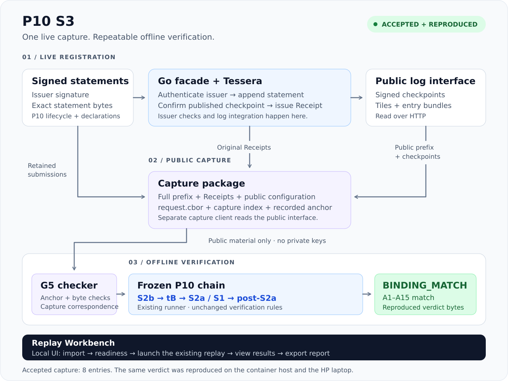

# P10 S3 — From live registration to offline replay

**Register signed statements. Capture the public log. Reproduce the accepted result offline.**

P10 S3 connects a running transparency log to a repeatable verification workflow. A Go registration front-end authenticates issuers and writes their statements to Tessera. A separate capture client collects the log's public output and the returned Receipts. The frozen P10 chain then checks that capture offline, using public material only.

**The full workflow has been executed and accepted.** Its `BINDING_MATCH` verdict has been reproduced byte for byte on the operator's HP laptop, both from the offline package and through the Replay Workbench.



**IETF draft:** [P10 Underdetermination Profile: Adjudication Statements over SCITT (revision -01)](https://www.ietf.org/archive/id/draft-nestorov-scitt-p10-underdetermination-01.html) · [Datatracker](https://datatracker.ietf.org/doc/draft-nestorov-scitt-p10-underdetermination/).

## What we built

| Component | What it does |
|---|---|
| **Registration front-end + Tessera** | Verifies issuer signatures, appends the exact statement bytes and returns Receipts bound to a published checkpoint. |
| **Public capture client** | Reads the public log interface and retains the complete prefix, original Receipts, checkpoints and public configuration. |
| **Offline verifier** | Checks capture correspondence with G5, then runs the frozen S2b → S2a/S1 → post-S2a chain. |
| **Replay Workbench** | Provides a local browser interface to import the approved package, check the host, run replay and export a report. |

The three S3 stages are **S3-A: define the deployment**, **S3-B: capture the live event**, and **S3-C: replay the capture offline**. Reproduction means replaying the retained capture; a new live registration is a new event.

## Accepted and reproduced

Ivan Nestorov signed the deployment freeze and the capture acceptance on **8 October 2026**. These decisions are recorded as signed Git tags:

| Decision | Signed tag | Commit |
|---|---|---|
| **S3-A deployment frozen** | [`v0.1.0-s3a-frozen`](https://github.com/VolMax-Studio/p10-scitt-transparency-s3/tree/v0.1.0-s3a-frozen) | [`7c3b2d4b…`](https://github.com/VolMax-Studio/p10-scitt-transparency-s3/commit/7c3b2d4b919c356a566f8f5d3628d4f546e41afa) |
| **S3-B capture and S3-C result accepted** | [`v0.1.0-s3-accepted`](https://github.com/VolMax-Studio/p10-scitt-transparency-s3/tree/v0.1.0-s3-accepted) | [`5acc277a…`](https://github.com/VolMax-Studio/p10-scitt-transparency-s3/commit/5acc277a13dc122e39fcb5f9f3e646b06cc95009) |

The accepted capture contains **eight log entries**. The chain returns **`BINDING_MATCH`**, with all **A1–A15** binding checks matching. Subsequent offline runs, including the HP replay, produced the same `verdict.json` bytes:

```text
6368022f06cc6ef6e4c9698cd45e71c44db505b4bf8b5812aaf0cbe26f41db22
```

Follow the evidence: [accepted result](ts-prototype/evidence/s3b-capture/RESULT.md) · [second offline replay](ts-prototype/evidence/s3b-capture/REPRODUCIBILITY.md) · [HP package replay](packaging/offline-package/VALIDATION-hp-replay.md) · [HP Workbench replay](apps/replay-workbench/evidence/hp-20261009/NOTES.md).

## Try the replay

### Local browser application

From this repository:

```bash
python3 apps/replay-workbench/run.py
```

Open **S3 — Accepted capture replay**, import the approved rev2 package, enter your Lean directory and optionally your public allowed-signers file, then select **Check readiness → Run replay**. The Workbench shows application execution, the P10 outcome and accepted-result reproduction separately.

Version **0.3.1** includes saved host settings, a desktop launcher, job history and report export. The HP replay is backed by exported reports; the latest navigation and settings checks are [operator-reported](apps/replay-workbench/evidence/v0.3.1/HP_OPERATOR_REPORT.md). See the [Workbench guide](apps/replay-workbench/README.md) for setup.

### Command-line replay

Extract the approved package and run from its root:

```bash
LEAN_BIN=/absolute/path/to/lean/bin ./verify_offline.sh
```

The approved archive is **`p10-s3-offline-e56d3ea-rev2.tar.gz`**:

```text
e19f8d84cac0ecb2de61dbd0e7085014d525829ba51007b7fdaa24895df37d9b
```

The operator holds the archive; it is not hosted in this repository. [Package instructions](packaging/offline-package/README_PACKAGE.md) describe verification and setup.

**Host requirements:** Linux x86_64, Python 3.12+ for the Workbench, Rust **1.82.0**, pinned Lean **4.33.0**, a C toolchain with libuv, and permission to create a network namespace. The package supplies the verifier artifacts and pinned source checkouts. The first replay builds Lean helpers; later runs can reuse them. Readiness identifies missing prerequisites before replay.

## Explore the project

| Area | Start here |
|---|---|
| Deployment and registration | [Deployment definition](deployment/candidate/) · [registration interface](spec/registration-interface.md) · [Go front-end and capture client](ts-prototype/) |
| Accepted capture | [Capture, anchor and results](ts-prototype/evidence/s3b-capture/) |
| Verification | [Runner contract](verifier/runner/CONTRACT.md) · [chain map](spec/acceptance-runner-map.md) · [G5 checker](verifier/g5/) |
| Reproduction and application | [Offline package](packaging/offline-package/) · [Replay Workbench](apps/replay-workbench/) |
| Design and experiments | [Preregistration](S3_PREREG_v0.1.md) · [TS selection](ts-selection/) · [feasibility spike](spike/) · [offline tests](tests/offline/) |

## Scope

This demonstration uses the declared **toy P10 profile**. `BINDING_MATCH` establishes the binding checked by the frozen chain; it does not establish scientific truth or prove enforcement of the published registration policy. The implementation makes no claim of full RFC 9943 or SCRAPI compliance. Both hosts were run by the same operator, so the HP replay demonstrates reproduction across hosts, rather than independent operator validation. Keys remain outside the repository; retirement is a separate operator action.

<details>
<summary><strong>Signed identities, signature verification and the historical freeze</strong></summary>

| Tag | Tag object | Target commit |
|---|---|---|
| `v0.1.0-s3a-frozen` | `8f0c97f3745131f79936dec71ebe09316332f5ab` | `7c3b2d4b919c356a566f8f5d3628d4f546e41afa` |
| `v0.1.0-s3-accepted` | `4148a7403e8d5ed0a30ca878d617323bb3a75b3a` | `5acc277a13dc122e39fcb5f9f3e646b06cc95009` |

Obtain Ivan's public signing key through a trusted channel and put it in a Git allowed-signers file. From a checkout:

```bash
git fetch --tags
git -c gpg.ssh.allowedSignersFile=/absolute/path/to/allowed-signers verify-tag v0.1.0-s3a-frozen
git -c gpg.ssh.allowedSignersFile=/absolute/path/to/allowed-signers verify-tag v0.1.0-s3-accepted
```

The capture and anchor were committed at `149953c29780e566b0b23f7a1b975dc93349daf2` before verification. The capture-index SHA-256 is `2662c2daf912d2ce4796a26b13464d7bc2df6ba8825fa399fed3a87185d700a7`; it is an operator-recorded anchor.

This README is a current project overview. The historical README belongs to the **99-file frozen set** and remains preserved at the signed tags. On the current branch, the other **98** frozen files retain their frozen contents; checking the old freeze manifest here therefore reports a README mismatch. Check all 99 in a separate checkout of the frozen tag. The approved offline package uses its pinned repository copy at `e56d3ea8bbe14c9c88a0dde339c29b55b1032a66`, where all 99 match.

The signed decisions also explain the adoption of the declared verification TCB. Source review and executed validation support that adoption; no formal proof of the glue is asserted. Historical experiments and their evidence remain identifiable in their original directories.

</details>

**Project:** Ivan Nestorov / VolMax-Studio — author, operator and ratifier. Implementation assistance: Claude Code. Architecture and review assistance: ChatGPT / Sol. Implementation history is recorded in commits; Ivan's freeze and acceptance are recorded in the signed tags above.

## License

Original S3 code and documentation: **MIT OR Apache-2.0**, at your option. See [LICENSE-MIT](LICENSE-MIT), [LICENSE-APACHE](LICENSE-APACHE) and [NOTICE.md](NOTICE.md). Third-party components retain their applicable licenses.
