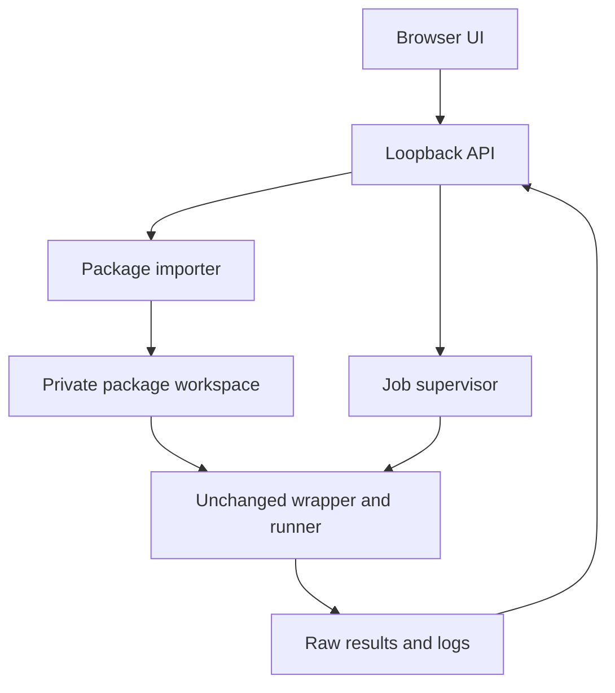

# P10 Replay Workbench — architecture v0.1

Implementation blueprint, 2026-10-09. This is a new application layer outside the frozen S3 set. It does not amend S3 acceptance, ratify an application, or change an upstream verifier.

## 1. Implementation decisions

Implement **P10 Replay Workbench** in `apps/replay-workbench/` in `VolMax-Studio/p10-scitt-transparency-s3`, on `claude/upbeat-allen-pmvtze`. The reviewed baseline is `ac8a8733730cd7959b511340ee1c874d90411733`. Use a new directory in the existing repository; a new repository is unnecessary for this first module.

Use Python 3.12 or newer, its standard library, and local HTML/CSS/JavaScript. No npm, CDN, framework, database, external service, or private key is required. Support Linux x86_64 first. Keep code and public-facing text in English.

The first module reproduces the **existing accepted S3 capture from the exact rev2 offline package**. It does not accept arbitrary captures or execute scripts from arbitrary archives. Future modules can support other profiles through the interface in section 10.

The real execution path uses the package's unchanged `verify_offline.sh`, which invokes the unchanged runner. Application readiness checks are mechanical diagnostics; the wrapper and runner repeat their own authoritative checks when execution starts. No COSE, CBOR, Lean, transcript, or P10-rule implementation belongs in the application.

The existing 99 frozen files, accepted evidence, upstream checkouts, artifacts, deployment configuration, packages, signed tags, and keys remain unchanged. Application commits add files only under `apps/replay-workbench/`, including its own documentation, tests and evidence. Do not regenerate the repository-wide manifest as part of application development; use an application-local evidence manifest.

## 2. Components and storage



Suggested files:

| File or directory | Responsibility |
|---|---|
| `run.py` | CLI bootstrap, loopback server, optional browser opening |
| `workbench/server.py` | Explicit HTTP routes and request validation |
| `workbench/importer.py` | Streamed upload, approved archive hash, bounded extraction |
| `workbench/jobs.py` | One active worker, events, cancellation, restart recovery |
| `workbench/worker.py` | Dedicated process; resource settings and offline subprocesses |
| `workbench/records.py` | Structural validation and preservation of output records |
| `workbench/reports.py` | Separate app report and export archive |
| `workbench/modules/s3.py` | S3 profile, mechanical readiness, fixed command, result collection |
| `profiles/s3-accepted-rev2.json` | Declarative package, source, binary and reference identities |
| `static/` | Local UI assets |
| `tests/` | Import, supervision, presentation and HTTP-boundary tests |
| `README.md`, `ARCHITECTURE.md` | Setup, launch, scope and limitations |

Default workspace: `$HOME/.local/share/p10-replay-workbench/`, private to the user (directory mode 0700, restrictive umask). This is a **new path**, separate from `volmax-s3-custody` and existing S3 checkouts.

Keep the uploaded archive unchanged under `archives/<sha256>/`. Keep one managed extraction under `packages/<sha256>/p10-s3-offline/`. Reusing this extraction permits reuse of ignored Lean build caches; tracked inputs are rechecked before every run. Job outputs live under `runs/<job-id>/`, outside the package and capture. Create a new, previously nonexistent runner-output directory for each job.

Do not delete existing packages, evidence or keys. Do not expose a general filesystem browser or arbitrary-file HTTP endpoint. Results are served through an explicit artifact allowlist scoped to a known job.

## 3. Trusted S3 profile

The shipped profile contains the following fixed identities. Operator inputs are the package upload and absolute-path text fields for the Lean bin directory and optional **public** allowed-signers file. Do not assume a browser file picker reveals absolute host paths. These inputs cannot override profile hashes, executable paths, expected outcomes or commands.

| Identity | Value |
|---|---|
| Profile ID | `p10-s3-accepted-e56d3ea-rev2` |
| Archive | `p10-s3-offline-e56d3ea-rev2.tar.gz` |
| Archive SHA-256 | `e19f8d84cac0ecb2de61dbd0e7085014d525829ba51007b7fdaa24895df37d9b` |
| Extracted root | `p10-s3-offline` |
| S3 package HEAD | `e56d3ea8bbe14c9c88a0dde339c29b55b1032a66` |
| Freeze tag object | `8f0c97f3745131f79936dec71ebe09316332f5ab` |
| Freeze tag target | `7c3b2d4b919c356a566f8f5d3628d4f546e41afa` |
| Acceptance tag object | `4148a7403e8d5ed0a30ca878d617323bb3a75b3a` |
| Acceptance tag target | `5acc277a13dc122e39fcb5f9f3e646b06cc95009` |
| S1 HEAD | `e4db3747eaeeb1a07227bb9029f9a9c3b566cdb1` |
| S2a HEAD | `741d56d36d7b2bfe2e9e0080a1cba4393e4a47da` |
| S2b HEAD | `8eaa91cad1ffa963158b365c6d0d7316f4965e89` |
| Capture anchor | `2662c2daf912d2ce4796a26b13464d7bc2df6ba8825fa399fed3a87185d700a7` |
| Accepted verdict SHA-256 | `6368022f06cc6ef6e4c9698cd45e71c44db505b4bf8b5812aaf0cbe26f41db22` |
| Rev2 wrapper SHA-256 | `59b638e048a535bce74687580486b72c8290f7d6155dc876471a33a899939359` |
| Runner `s3c_verify.py` SHA-256 | `7e6c457a6cc54e7a5c05610f80361201aa958022e44d8aa303a982ffbe95f628` |
| Runner `s3c_chain.py` SHA-256 | `de3450bbb1b6268773bbee9eb7bc2d5e86d2ad433d59985b8ccf05b56bd50494` |
| Reused `preflight.py` SHA-256 | `8b95eadbedc42ce53c303514962601fa6ae630da123208a0a9464bc8c2b83c5d` |
| Entry binary SHA-256 | `53ba44408b1de7322010681f45bb4aa576931f0974c448d9e6b7a662683ca863` |
| G5 binary SHA-256 | `a2b4b1efeda26302ec5f0710905c46f7c180ad862035959d47ba1e33305ee0bd` |

Names are descriptive; the archive digest establishes whether an upload is supported. Unknown archives produce application status `UNSUPPORTED_PACKAGE`, before extraction or execution. They do not produce a P10 HALT or REJECT. The UI does not offer a bypass, a custom runner, an expected-verdict override, or arbitrary command arguments.

The profile is trusted application data, reviewed with application source. Include its SHA-256 and the application source identity in every app report. Package-internal declarations do not establish their own trust.

## 4. Import and readiness

### Import

Stream the uploaded archive to a private temporary file while hashing it. Enforce a 64 MiB compressed upload limit. Verify the approved archive digest **before executing any packaged file**. Only then inspect and extract.

For v0.1, extraction accepts directories and regular files only, beneath the single expected root. Reject absolute paths, traversal, duplicate normalized destinations, non-UTF-8 names, backslashes, NUL/control characters, links and special files. Enforce at most 25,000 members and 512 MiB total declared and actually written file bytes. Validate every destination and ancestor. Do not use unrestricted `extractall`; do not preserve ownership or setuid/setgid/sticky bits. Retain ordinary executable bits needed by the shipped artifacts. On any error, discard only the application's new partial extraction.

Confirm that the real rev2 archive fits this import contract; report an unsupported member or size before execution rather than silently rewriting the package. These limits govern the application importer, not frozen P10 semantics.

### Readiness

The UI's **Check readiness** action must not launch the chain or build its Lean helpers. It may write readiness records and temporary native-link probes in the app workspace. It may invoke the verified existing `spike/host/preflight.py`, which performs static/runtime probes, inside an offline subprocess. Describe this accurately rather than promising zero filesystem writes.

Mechanical checks include:

1. Required commands and locally installed Rust 1.82.0; selected Lean directory and its pinned executables/libraries.
2. Available network-namespace launch method (`unshare -n`, otherwise `unshare -rn`). A failure blocks execution; report diagnostics.
3. `PACKAGE_SHA256SUMS` and `freeze-set.sha256`, using `sha256sum -c` exit status. Preserve diagnostics, including silent nonzero failures. Display counts actually read.
4. Exact package/dependency HEADs, cleanliness of tracked source files, tag objects and peeled targets, anchor, wrapper/source/binary hashes and accepted-reference hash.
5. Optional tag-signature verification against the supplied public allowed-signers file. With no file, display **Signature not checked**, separately from signature presence. This matches the existing wrapper's optional check; do not invent a new P10 acceptance rule.
6. Workspace paths, free disk and current available memory. Record resource observations; they are not evidence about P10.

Readiness is advisory and expires on input/configuration changes. Run repeats it and then invokes the unchanged wrapper, which independently repeats its checks. The accepted reference is not passed to the runner: hashing its existing file during readiness is permitted; comparison with the new verdict occurs only after execution.

No web action installs tools, invokes sudo, changes sysctl/AppArmor, regenerates keys, signs tags, or contacts a remote URL. A blocked namespace prerequisite produces a visible host-setup problem. Namespace policy is managed separately by the operator.

## 5. Execution, resource use and cancellation

Create one dedicated worker process per job. Allow at most one active readiness/run job; reject a second start without silently queueing it. Keep HTTP handling responsive. Run the worker with lower scheduling priority and at most two available CPUs using Linux process affinity, before launching subprocesses. These settings limit CPU scheduling; they are not a RAM limit or a guarantee against desktop failure. Display available-memory observations and a Stop control. Do not add swap or alter host limits automatically.

Use `subprocess` argument arrays and `shell=False`. Never interpolate UI inputs into a shell command. Do not use `preexec_fn` in the threaded server; resource setup belongs in the dedicated worker.

The worker executes the trusted wrapper under a newly created network namespace. Try `unshare -n`, then `unshare -rn` only when namespace creation fails. Never retry a wrapper or runner that has started. Keep the selected method in the report. The UI server remains outside that namespace on loopback; job I/O uses pipes and files. The unchanged runner still creates/tests its own namespace and its **measured** `network_isolated` remains the acceptance evidence.

Fixed wrapped command, shown here as an argv template:

```text
[unshare, selected_namespace_flags, --,
 bash, <managed-package>/verify_offline.sh, <fresh-absolute-runner-output>]
```

Supply absolute `LEAN_BIN` and, when selected, `ALLOWED_SIGNERS`. The latter is a private workspace copy of the public file, with its digest recorded. The wrapper supplies the same existing runner arguments; no `--no-offline`, `--pinned`, `--_inner`, fixture or expected-verdict argument is supplied by the application.

Build a deliberate subprocess environment from required host paths and toolchain locations. Strip `VERIFY_OFFLINE_TEST_EXPECT`, `VERIFY_OFFLINE_SOURCE_ONLY`, `BASH_ENV`, `ENV`, injected Python/library paths and command-wrapper overrides. No runtime test-mode or hash-bypass setting is exposed. Avoid automatic toolchain installation; prepare dependencies separately. Namespace isolation also prevents wrapped tools from reaching external download endpoints.

Use a fresh process session/group and retain its identity. Drain stdout and stderr concurrently into separate logs, with bounded UI tails. Show observable phases and elapsed time; do not fabricate a percentage or infer unseen S2a completion. Trusted wrapper phase headers can be used for navigation, never for the verdict.

Default job deadline: 60 minutes, configurable at launch and recorded. Limit each output log to 64 MiB; exceeding the limit is an application failure. Cancellation/deadline/shutdown sends TERM to the job process group, waits five seconds and then sends KILL if necessary; test child cleanup. Preserve partial files and the cancellation reason. Do not convert interruption into P10 HALT/REJECT or use partial records to report reproduction success.

On restart, identify unfinished jobs as interrupted until their process state is established. Never automatically rerun them or promote leftover files into a successful result. A new attempt has a new job ID.

## 6. Three separate result axes

The application must keep these independent:

| Axis | Source | Examples |
|---|---|---|
| Application execution | App supervisor | `BLOCKED`, `RUNNING`, `COMPLETED`, `CANCELLED`, `APP_FAILURE` |
| P10 runner outcome | Original `verdict.json` | `BINDING_MATCH`, `REJECT`, `HALT`, `S3-FAIL(packaging)`, `S3-FAIL(infrastructure)` |
| Accepted-reference reproduction | Post-run byte comparison and profile conditions | `MATCH`, `DIFFERENT`, `NOT_EVALUATED` |

Preserve the runner's `stage`, `reason`, `code`, `rule`, and A1–A15 rows exactly as present. Missing rows are unavailable, never implicit matches. Application reasons have their own namespace and are not written into the runner's verdict.

**Exit-code distinction:** the wrapper uses 0 for full replay success, 1 for failed replay/comparison, 2 for prerequisite/output refusal, and 3 for its test mode. Runner codes 0/11/12/30/40/2 belong to the inner runner; the wrapper does not propagate all of them. Save `wrapper_exit` separately. Read the P10 outcome from structurally valid raw records. Do not label wrapper exit 1 as a P10 REJECT. A textual `runner exit code` line may be retained as a log observation, not used as the authority for a P10 result.

| Observed combination | Presentation |
|---|---|
| Wrapper 0, valid matching records and all profile conditions | Completed; P10 `BINDING_MATCH`; reproduction `MATCH` |
| Wrapper 1, valid P10 `REJECT` or `HALT` | Preserve that P10 outcome; reproduction `DIFFERENT` |
| Wrapper nonzero, valid S3-FAIL record | Preserve S3-FAIL; reproduction `NOT_EVALUATED` |
| Wrapper 1, valid `BINDING_MATCH` but different verdict bytes | Preserve `BINDING_MATCH`; reproduction `DIFFERENT` |
| Wrapper 2 with no runner record | Blocked; P10 not evaluated |
| Wrapper 0 with missing/malformed/contradictory records | `APP_FAILURE`; no reproduction-success badge |
| Cancellation, deadline or process crash | Interrupted application result; preserve any partial/raw records without promotion |
| Wrapper 3 | Invalid test-mode invocation; no success badge |

Structurally validate bounded UTF-8 JSON, rejecting duplicate keys and non-finite numbers. Validate needed field types and known top-level outcome values; do not interpret P10 rules or maintain a new list of P10 reason tokens. Use identity checks for booleans (`is True`), not integer/boolean equality. Preserve original bytes; do not canonicalize a runner record before comparison.

The **Accepted replay reproduced** badge requires wrapper exit 0; valid `BINDING_MATCH`; exact byte equality to both accepted reference files and the approved verdict digest; both executable pins present and true; measured `network_isolated=true`; exact recorded runner/binary hashes; no reported problems or TCB source mismatch; and completed checks requested for this job. A contradictory zero exit is an application failure. These are presentation/record checks around the existing acceptance result, not a second implementation of P10.

Show signature status independently. `BINDING_MATCH` concerns the authenticated capture and frozen chain; it is not evidence of scientific truth, policy enforcement, full RFC 9943/SCRAPI compliance or independent operators.

## 7. Local UI and API

Use `ThreadingHTTPServer` with a custom `BaseHTTPRequestHandler`, bound only to `127.0.0.1` and an available port. This is a single-user local tool, not an Internet-facing service. Do not use directory-serving handlers.

Generate an unpredictable per-session token. Open the browser with that token in a URL fragment, not a logged query string. The UI sends it in a custom header for every API request. Validate the exact Host header; require the exact same Origin on state-changing requests; reject cross-origin access and do not enable CORS. Bound request sizes/timeouts and use explicit JSON schemas. Tokens are not exported in evidence.

Suggested routes:

| Route | Purpose |
|---|---|
| `GET /` and explicit static assets | Local UI |
| `GET /api/modules` | Built-in module/profile descriptions |
| `POST /api/packages` | Bounded, streamed raw archive upload |
| `POST /api/inspect` | Readiness for a managed package and selected host configuration |
| `POST /api/runs` | Start one fresh job |
| `GET /api/runs/<id>` | Status and structured result |
| `GET /api/runs/<id>/events?after=<sequence>` | Bounded progress/log polling |
| `POST /api/runs/<id>/cancel` | Stop the job |
| `GET /api/runs/<id>/report` | Export a completed or partial evidence report |

Use text rendering (`textContent`) for logs, reasons, paths and all imported text. Serve only local assets, with a restrictive content-security policy. Do not disclose arbitrary local files. Loopback plus a token does not create a security boundary against a malicious process of the same user.

Readiness and replay start asynchronously: return HTTP 202 with a job ID, then poll status/events. The job kind distinguishes readiness from replay; readiness has no P10 outcome. Bound ordinary JSON bodies to 64 KiB, use a bounded upload read deadline, and do not keep an HTTP request open for a Lean build. Closing a browser tab does not cancel a job; the explicit Stop action or application shutdown does.

The initial screen has package selection, Lean-directory selection and optional public allowed-signers selection; readiness rows; Run/Stop; observable phase and logs; and three separate result panels. Expose hashes and raw records in a details view. No automatic acceptance, key-retirement or publication button exists.

## 8. Reports

Keep `verdict.json`, `run-info.json` and `preflight.json` as original artifacts. Add a **separate** `app-report.json`, never a replacement verdict. Include:

- App format/version, source identity, profile ID/digest and archive digest.
- Job identity, command argv, wrapper exit or signal, timestamps/duration and cancellation/deadline reason.
- Readiness observations, optional signature status and public allowed-signers digest.
- Raw artifact hashes, original P10 outcome/stage/reason, reproduction status and its checks.
- Host/runtime/resource configuration and explicit limitations.

Write metadata atomically. Export `app-report.json`, original records, stdout/stderr logs, profile copy and `REPORT_SHA256SUMS` into a small report archive. Include only allowlisted job artifacts. Do not export custody material, private keys, the full package/Git tree or cache directories. Explain that logs and records may contain local host names and paths; export is an operator action. A text/HTML summary is optional and derived from the same report model. No timestamp or app-generated report is presented as an independent attestation.

## 9. Focused tests and delivery

Test new application behavior with injected unit-test dependencies and synthetic records. Production accepts only the real approved profile; there is no HTTP/environment switch enabling synthetic packages or custom scripts.

Meaningful test cases:

1. Unknown archive hash: no extraction or packaged-code execution.
2. Traversal, duplicate destinations, links/special members and size limits: import fails before execution.
3. Readiness failure and silent nonzero checksum status: no wrapper job starts.
4. Fixed argv/environment; no forbidden runner options; overrides stripped; output is fresh and separate.
5. Wrapper 0 plus valid reference records gives reproduction match.
6. Valid REJECT, HALT and S3-FAIL records remain distinct despite wrapper exit 1.
7. Wrapper 0 with bad/missing JSON, duplicate keys, invalid types, missing pins or false isolation cannot show success.
8. `ALL PASS` printed by a stub without valid records cannot show success.
9. Reference comparison happens after completion; references are never runner inputs.
10. Cancellation/deadline kills the test job and its child; partial records survive without a success badge.
11. One active job, restart recovery and bounded logs/events.
12. Host/Origin/token checks, escaped hostile log text, and report artifact allowlists.

These test the app's import, orchestration and presentation; they do not recreate semantic S2b families. Record a stub/test result as such, never as an offline P10 run.

Deliver an ordinary app-source commit, README with the full launch command, tests, screenshots/manual UI notes and an app-local evidence manifest. Check that every path in `deployment/candidate/freeze-set.sha256` is untouched relative to the reviewed baseline. Do not modify accepted evidence or rebuild supplied entry/G5. A later HP run through the app demonstrates integration of the new interface; the existing accepted S3 and second-host record already stand on their own.

Example launch after implementation:

```bash
python3 apps/replay-workbench/run.py
```

No signing, tag, merge, release, visibility change or key retirement is part of this implementation task.

## 10. Module interface and future scope

Keep a small built-in registry rather than a plugin loader. Each module implements:

```text
describe() -> module capabilities and fixed profiles
inspect(managed_package, host_config) -> mechanical readiness records
command(managed_package, host_config, fresh_output) -> fixed argv/environment
collect(job_exit, output_artifacts) -> preserved outcome and reproduction checks
```

Core owns uploads, workspaces, supervision, cancellation, HTTP, logs and export. Modules own their profiles, fixed commands and structural record mappings. Uploaded archives cannot supply executable module code. Only S3 ships in v0.1. Supporting new captures, other domains or arbitrary adjudication packages requires a separately reviewed module/profile and is outside this first implementation.

## 11. Reference sources

- S3 repository baseline: `ac8a8733730cd7959b511340ee1c874d90411733`.
- Rev2 wrapper implementation: `packaging/offline-package/verify_offline.sh`, first fixed at `fcd15e41a3e2aa2b1ba1b5752b8dd93f80aeaf2d`.
- Existing contracts: `verifier/runner/CONTRACT.md`, `PINNED_INPUTS.json`, `spec/capture-format.md`, and the package README/validation records.
- Python HTTP server: https://docs.python.org/3.12/library/http.server.html (basic local server; not recommended as a production service).
- Python subprocess API: https://docs.python.org/3.12/library/subprocess.html (argument arrays, process lifecycle, timeout/environment behavior).
- Python tar API and extraction limitations: https://docs.python.org/3.12/library/tarfile.html (archive extraction still needs application bounds and validation).
